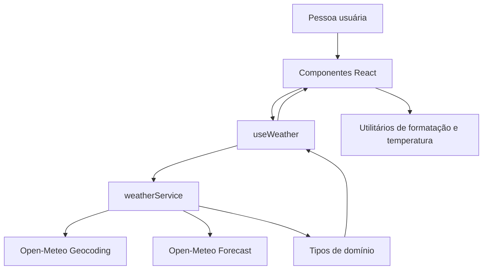

# Plano Técnico — Weather App

## Architecture

Aplicação client-side em camadas, sem backend próprio. Cada camada depende apenas da camada abaixo ou de contratos compartilhados; chamadas à Open-Meteo ficam isoladas no serviço. Componentes não fazem `fetch`, e o serviço não conhece React nem texto de interface.



Responsabilidades:
- **Apresentação (`components/`):** renderizar props/estado e emitir ações do usuário. Contém busca e seleção explícita de cidade, condições atuais, previsão, alternância de unidade e estados acessíveis. Não coordena chamadas externas.
- **Orquestração (`hooks/`):** manter estado da jornada e coordenar busca, seleção, carregamento, erros, retry e proteção contra respostas fora de ordem. Depende dos serviços e expõe uma interface consumível pelos componentes.
- **Acesso a dados (`services/`):** montar solicitações, impor timeout, verificar respostas externas e mapear Open-Meteo para os tipos de domínio. Não contém React, estado da tela ou mensagens de apresentação.
- **Funções puras (`lib/`):** conversão/arredondamento de temperatura, formatação de datas e tradução dos códigos WMO. Não fazem I/O nem mantêm estado; recebem valores e retornam resultados.
- **Contratos (`types/`):** tipos compartilhados de domínio e estado, sem dependência de UI ou API.

Uma busca bem-sucedida exibe opções; a consulta meteorológica começa somente após seleção explícita. Não selecionar automaticamente o primeiro resultado.

## Tech Stack

| Área | Decisão | Motivo |
| --- | --- | --- |
| Linguagem | TypeScript strict | Tipar contratos e respostas externas; reduzir estados inválidos. |
| UI | React 19 | Componentes e estado local adequados à aplicação client-side. |
| Build/dev server | Vite | Já adotado pelo repositório; build estático sem backend. |
| Estilos | Tailwind CSS | Já adotado pelo repositório e suficiente para a UI responsiva. |
| Dados | Fetch nativo + AbortController | Evita dependência adicional para poucas chamadas HTTP e implementa cancelamento/timeout. |
| API | Open-Meteo Geocoding e Forecast | Atende à fonte definida na spec, sem chave. |
| Testes | Vitest, Testing Library, Playwright | Testes unitários/componentes e fluxos reais no navegador. |
| Qualidade | Biome | Lint e formatação já configurados no projeto. |
| Pacotes | pnpm | Gerenciador já configurado no projeto. |

Não introduzir biblioteca global de estado ou cliente HTTP enquanto houver somente uma tela e dois endpoints relacionados.

## Project Structure

Preservar as pastas existentes e manter um componente por arquivo. Criar um componente novo apenas se a seleção de resultados precisar de uma unidade independente de apresentação; não criar diretórios de domínio ou abstrações genéricas nesta versão.

```text
src/
  App.tsx
  main.tsx
  components/
    SearchBar.tsx       # Entrada/envio de busca e seleção de resultado
    CurrentWeather.tsx  # Condições atuais
    ForecastList.tsx    # Lista de previsão
    ForecastCard.tsx    # Apresentação de um dia
    UnitToggle.tsx      # Unidade de temperatura
    states/             # Loading, erro, vazio e sem dados
  hooks/
    useWeather.ts       # Estado e orquestração da jornada
  services/
    weatherService.ts   # Geocoding, forecast, timeout e mapeamento
  lib/
    temperature.ts      # Conversão/arredondamento puro
    format.ts           # Formatação de data e valores
    weatherCodes.ts     # Código WMO para rótulo em pt-BR
  types/
    weather.ts          # City, CurrentConditions, ForecastDay, WeatherData, Unit
  styles/
    index.css           # Tailwind e estilos globais
tests/
  unit/                 # Testes isolados de lib, services, hooks e componentes
  e2e/                  # Fluxos completos no navegador
```

| Camada | Contrato e dependências | Teste que a isola |
| --- | --- | --- |
| `components/` | Recebe props/estado e emite eventos; usa hooks, tipos e funções de apresentação, nunca o serviço diretamente. | Testing Library verifica conteúdo, interação, teclado, acessibilidade e estados com callbacks/dados controlados. |
| `hooks/` | Expõe estado da jornada e ações; chama operações de `services/`, não manipula DOM nem formata valores. | Testes do hook com serviço mockado verificam transições, retry, seleção e descarte de respostas obsoletas. |
| `services/` | Exporta operações tipadas; único ponto que conhece URLs, parâmetros, HTTP e payload externo. | Vitest com `fetch` mockado verifica requests, timeout, validação e mapeamento sem rede real. |
| `lib/` | Funções determinísticas sem efeitos colaterais; não importa React nem services. | Testes unitários com entradas/saídas e limites conhecidos, sem mocks. |
| `types/` | Contratos compartilhados; não importa outras camadas. | Verificação TypeScript no build; os contratos também são exercitados pelos testes de mapeamento e componentes. |

Essa direção permite testar regra de domínio sem navegador, serviço sem API real e UI sem depender de rede. Playwright cobre a integração entre camadas e os critérios ponta a ponta.

## Data Model

Modelo de domínio independente dos nomes e do formato dos campos da API. Valores ausentes são `null`, nunca substituídos por zero ou estimativas. Temperaturas são mantidas em Celsius sem arredondamento; o arredondamento ocorre somente ao exibir.

```ts
type TemperatureUnit = 'celsius' | 'fahrenheit';

interface City {
  id: number;
  name: string;
  country: string;
  region?: string;
  latitude: number;
  longitude: number;
}

interface CurrentConditions {
  observedAt: string;
  temperatureC: number | null;
  weatherCode: number | null;
  humidityPercent: number | null;
  windSpeedKmh: number | null;
  pressureHpa: number | null;
  precipitationMm: number | null;
}

interface ForecastDay {
  date: string; // YYYY-MM-DD no fuso da cidade
  temperatureMinC: number | null;
  temperatureMaxC: number | null;
  weatherCode: number | null;
  precipitationTotalMm: number | null;
  windSpeedMaxKmh: number | null;
}

interface WeatherData {
  city: City;
  timezone: string; // Identificador IANA retornado pela API
  current: CurrentConditions;
  forecast: ForecastDay[]; // Exatamente 5 dias em uma resposta utilizável
}
```

Estados da tela devem distinguir `idle`, `searching`, `cities`, `loading-weather`, `success`, `empty`, `no-data` e `error`. O estado de erro guarda a operação que falhou (`geocoding` ou `weather`) e o alvo necessário para repetir a mesma operação. A unidade selecionada é estado de apresentação em memória; não persiste entre sessões.

## Data Flow

1. Na abertura, apresentar busca vazia; não chamar geocoding, forecast ou geolocalização.
2. Ao enviar texto não vazio, remover apenas espaços externos e solicitar geocoding. Codificar a consulta como parâmetro URL, preservando caracteres significativos.
3. Em erro, apresentar recuperação; em zero resultados, apresentar estado sem resultados; com resultados, mostrar opções distinguíveis por cidade, país e região quando disponíveis.
4. Ao selecionar uma opção, armazenar a cidade selecionada e carregar condições atuais e cinco dias para suas coordenadas.
5. Validar e mapear a resposta para `WeatherData`. Renderizar campos válidos e identificar campos ausentes como indisponíveis; uma cobertura diária diferente de cinco dias não deve ser completada artificialmente.
6. Ao alternar Celsius/Fahrenheit, recalcular todas as temperaturas a partir do Celsius original, sem novo request; manter todos os outros dados inalterados.
7. Em buscas ou seleções subsequentes, somente a resposta da ação mais recente pode atualizar a UI. Cancelar requisições anteriores quando possível e também ignorar respostas obsoletas.

## External APIs

### Geocoding

- **URL:** `https://geocoding-api.open-meteo.com/v1/search`
- **Método:** `GET`.
- **Parâmetros relevantes:** `name` (texto após `trim`, codificado por `URLSearchParams`), `count=5`, `language=pt` e `format=json`.
- **Exemplo de resposta resumida:**

```json
{
  "results": [
    {
      "id": 3448439,
      "name": "São Paulo",
      "latitude": -23.5475,
      "longitude": -46.6361,
      "country": "Brasil",
      "admin1": "São Paulo"
    }
  ],
  "generationtime_ms": 0.2
}
```

- **Mapeamento para `City`:** `id`, `name`, `country`, `latitude` e `longitude` são mapeados diretamente; `admin1` vira `region`. Exigir ID, nome, país não vazio e coordenadas numéricas válidas para tornar o resultado selecionável, conforme AC1.1. Ignorar resultados sem esses campos obrigatórios e metadados que não são usados pela UI.
- **Sem resultados:** resposta sem `results` ou com `results: []` corresponde ao estado `empty`; erro HTTP, rede ou JSON inválido é erro recuperável, não lista vazia.

### Forecast

- **URL:** `https://api.open-meteo.com/v1/forecast`
- **Método:** `GET`.
- **Parâmetros:** `latitude` e `longitude` da cidade selecionada; `current=temperature_2m,weather_code,relative_humidity_2m,wind_speed_10m,surface_pressure,precipitation`; `daily=weather_code,temperature_2m_min,temperature_2m_max,precipitation_sum,wind_speed_10m_max`; `timezone=auto`; `forecast_days=5`; `temperature_unit=celsius`; `wind_speed_unit=kmh`; `precipitation_unit=mm`.
- **Nota sobre o exemplo:** os arrays de `daily` abaixo mostram somente dois itens por brevidade; uma resposta usada como previsão completa deve conter cinco datas e valores alinhados por índice.
- **Exemplo de resposta resumida:**

```json
{
  "timezone": "America/Sao_Paulo",
  "current": {
    "time": "2026-10-20T14:00",
    "temperature_2m": 22.4,
    "weather_code": 2,
    "relative_humidity_2m": 61,
    "wind_speed_10m": 8.3,
    "surface_pressure": 925.1,
    "precipitation": 0
  },
  "daily": {
    "time": ["2026-10-20", "2026-10-21"],
    "weather_code": [2, 3],
    "temperature_2m_min": [17.1, 18.0],
    "temperature_2m_max": [25.2, 26.4],
    "precipitation_sum": [0.0, 1.2],
    "wind_speed_10m_max": [16.5, 18.0]
  }
}
```

- **Mapeamento para `CurrentConditions`:** `current.time` vira `observedAt`; `temperature_2m` vira `temperatureC`; `weather_code` vira `weatherCode`; `relative_humidity_2m` vira `humidityPercent`; `wind_speed_10m` vira `windSpeedKmh`; `surface_pressure` vira `pressureHpa`; `precipitation` vira `precipitationMm`.
- **Mapeamento para `ForecastDay`:** percorrer os arrays de `daily` pelo mesmo índice `i`; `time[i]` vira `date`, `temperature_2m_min[i]` e `temperature_2m_max[i]` viram temperaturas mínima/máxima, `weather_code[i]` vira `weatherCode`, `precipitation_sum[i]` vira `precipitationTotalMm` e `wind_speed_10m_max[i]` vira `windSpeedMaxKmh`.
- **Mapeamento para `WeatherData`:** combinar o `City` selecionado, `timezone` da resposta, o objeto `CurrentConditions` mapeado e os dias mapeados em ordem cronológica. As temperaturas permanecem em Celsius; conversão e arredondamento ocorrem na apresentação.
- **Validação:** conferir HTTP, JSON, tipos e comprimentos dos arrays. Preservar campos ausentes/nulos como indisponíveis; `0` é valor válido. Não preencher arrays desalinhados nem inventar datas. Exigir fuso válido e cinco datas locais para uma previsão completa; não usar o fuso do dispositivo como fallback.

Solicitações externas têm timeout de 10 s por request, conforme RNF1. `AbortController` interrompe o fetch; erros de rede, HTTP, timeout e payload inválido são convertidos para erros de domínio sem expor detalhes técnicos à UI.

## State Management

Manter estado na tela via `useWeather`, sem store global. O hook controla a consulta atual, resultados do geocoding, cidade selecionada, dados meteorológicos, erro e estado de carregamento. A unidade de temperatura fica em estado local separado, inicialmente Celsius.

Transições principais:
- `idle -> searching -> cities | empty | error`
- `cities -> loading-weather -> success | no-data | error`
- `success -> loading-weather` ao selecionar outra cidade
- `error -> searching | loading-weather` ao repetir a operação correspondente

Busca vazia é interrompida antes da chamada externa. O retry repete o texto de busca ou a cidade da tentativa que falhou. Atualizações assíncronas devem ser associadas a um identificador de request ou canceladas para impedir que respostas antigas substituam a seleção mais recente.

## Error Handling

| Situação | Estado/comportamento |
| --- | --- |
| Busca vazia | Nenhum request; solicitar nome de cidade. |
| Geocoding sem resultados | Estado `empty`; não consultar forecast. |
| Erro de rede, HTTP ou timeout | Estado `error`, mensagem pt-BR e retry para o mesmo alvo. |
| Resposta meteorológica sem campos utilizáveis | Estado `no-data`; não mostrar dados anteriores como atuais. |
| Resposta meteorológica parcial | Exibir valores válidos e marcar ausentes como “Indisponível”; não inventar valores. |
| Código WMO desconhecido | Exibir “Condição indisponível” sem descartar outros campos válidos. |
| Fuso horário ausente/inválido | Tratar como resposta inválida, sem usar o fuso do dispositivo; oferecer retry. |
| Troca de cidade durante request | Ignorar resultado obsoleto; nunca atribuí-lo à nova cidade. |

Loading aparece até 100 ms após envio. Cada request externo termina em resposta ou timeout em até 10 s. Mensagens não mostram stack traces, URLs ou detalhes internos da API.

## Testing Strategy

### Vitest — funções, serviços e componentes

Usar os testes existentes em `tests/unit/`, Testing Library e `user-event`; criar novos arquivos somente para módulos ainda sem cobertura. Verificar resultados observáveis, não detalhes internos de implementação.

| Alvo | Casos e verificações | Rastreabilidade |
| --- | --- | --- |
| Conversão pura de temperatura | 0 °C → 32 °F; 100 °C → 212 °F; −40 °C → −40 °F; empates positivos e negativos afastados de zero (2,5 → 3 e −2,5 → −3). Converter sempre a partir do Celsius original; repetir alternâncias sem acumular erro e preservar `null` como indisponível. | AC3.1–AC3.4 |
| Datas e códigos WMO | Datas pt-BR, ordem cronológica, mudança de dia quando o fuso da cidade difere do dispositivo e código desconhecido como “Condição indisponível”. Fixar relógio e fuso do ambiente para resultados reproduzíveis. | AC1.5, AC2.1–AC2.4, RNF7 |
| Geocoding com `fetch` mockado | Validar host, caminho e parâmetros com `URL`/`URLSearchParams`; preservar acentos, hífen e apóstrofo; remover somente espaços externos. Busca vazia não chama a rede. Cobrir resultados homônimos, ausência de `results`, lista vazia e registros inválidos. | AC1.1–AC1.4, AC1.7 |
| Forecast com `fetch` mockado | Conferir coordenadas da seleção, `current`, `daily`, unidades, `timezone=auto` e `forecast_days=5`. Mapear payload completo; cobrir nulos, campos/arrays ausentes ou desalinhados, zero válido, ausência total de dados, JSON inválido e fuso ausente/inválido. | AC1.5–AC1.6, AC2.1–AC2.4, AC4.3, AC4.5 |
| Falhas do serviço | Simular rejeição de rede, HTTP 429/5xx e timeout. Usar relógio falso e um mock que respeite o sinal de abort; aos 10 s, verificar cancelamento e erro recuperável. Restaurar mocks e timers após cada teste. | AC4.2, RNF1, RNF4 |
| Hook de orquestração | Mockar o serviço para verificar transições, seleção explícita, retry do texto/cidade que falhou e descarte de respostas obsoletas. Controlar a ordem de resolução das promises, sem esperas arbitrárias. | AC1.2, AC4.1–AC4.7 |

Componentes devem ser exercitados com dados e callbacks controlados; usar consultas por role/nome acessível e não seletores baseados em classes CSS:

- **Inicial:** busca disponível, orientação para escolher cidade, nenhum dado meteorológico e nenhuma consulta automática (AC4.7).
- **Loading:** indicador acessível enquanto a operação aguarda; não atribuir dados anteriores à nova seleção. Verificar o limite de 100 ms em teste de integração controlado (AC4.1, AC4.6).
- **Erro:** mensagem pt-BR, ação de nova tentativa acessível e chamada para o mesmo alvo; retirar o erro ao iniciar nova tentativa (AC4.2, AC4.4).
- **Vazio/sem dados:** distinguir geocoding sem localidades de resposta meteorológica sem campos utilizáveis; não exibir valores inventados (AC1.3, AC4.3).
- **Sucesso:** resultados selecionáveis por teclado e sem seleção automática; cidade correta, unidades, cinco datas e campos recebidos. Resposta parcial mantém campos válidos e marca ausentes como “Indisponível” (AC1.1–AC1.2, AC1.5–AC1.6, AC2.1–AC2.4, AC4.5).
- **Alternância de unidade:** atualizar temperaturas atuais e previstas, manter cidade/datas/outras medidas e verificar que a contagem de chamadas ao serviço não aumenta (AC3.1–AC3.4, RF4).

### Playwright — integração e mobile

Executar a aplicação real e interceptar geocoding/forecast com respostas controladas. Asserções devem usar fixtures com valores conhecidos; não depender do clima ao vivo nem aguardar tempos fixos.

| Fluxo | Verificações ponta a ponta |
| --- | --- |
| Busca → seleção → clima → unidade | Enviar com Enter e botão; distinguir homônimas; não consultar forecast antes da seleção. Conferir cidade, condições atuais, cinco datas locais e conversão de todas as temperaturas sem request adicional. |
| Busca inválida ou sem resultados | Espaços não geram request; nome inexistente informa ausência de localidades e não chama forecast. |
| Falha → retry → sucesso | Simular falha de geocoding e de forecast; retry mantém o respectivo alvo e permite completar a jornada. |
| Resposta parcial ou sem dados | Campos disponíveis continuam visíveis; ausentes são identificados; ausência total gera estado sem dados. |
| Seleções concorrentes | Atrasar a resposta de uma seleção anterior; somente a cidade selecionada mais recentemente pode aparecer como resultado atual. |
| Mobile e teclado | Repetir a jornada principal em 320 px e verificar layout também em 768 e 1280 px. Não pode haver rolagem horizontal, sobreposição ou controles inacessíveis. Testar toque, Tab, Enter e foco visível. |
| Nova sessão | Abrir contexto de navegador independente: busca inicial, Celsius padrão, sem cidade/consulta persistida e sem geolocalização automática. |

Cobrir integração em Chromium, Firefox e WebKit. Emulação mobile verifica viewport e toque, não substitui a validação dos navegadores/versões reais exigidos por RNF8.

### Gates e evidências

- **Rastreabilidade:** identificar cada teste pelos ACs cobertos da matriz da spec; todos os ACs devem ter ao menos uma verificação observável. Não usar percentual de cobertura como substituto de cenários de risco.
- **Qualidade de código:** nas fases Code/Test, executar `pnpm lint`, `pnpm build`, `pnpm test` e, para validar fluxos, `pnpm test:e2e`.
- **Performance (RNF1):** medir build de produção sob o perfil de rede e 20 execuções definidos na spec; calcular o percentil 75 do LCP. Testes de DOM com timers falsos não comprovam desempenho real.
- **Acessibilidade (RNF3):** complementar verificações automatizadas de semântica, foco e contraste com revisão manual por teclado e leitor de tela; a presença de uma live region não prova que os anúncios foram compreendidos.
- **Compatibilidade (RNF8):** registrar versões e plataformas validadas das duas versões estáveis mais recentes dos navegadores exigidos; os motores do Playwright não comprovam sozinhos toda essa matriz.

## Risks & Trade-offs

| Decisão | Benefício e custo/risco | Alternativa considerada |
| --- | --- | --- |
| Estado local em `useWeather` | Poucas dependências e estado perto da tela; exige controlar transições, retry e concorrência explicitamente. | Context/store global ou TanStack Query: úteis se surgirem múltiplas telas e compartilhamento de dados; desnecessários no escopo atual. |
| Fetch nativo + AbortController | Suficiente para dois endpoints; timeout deve cobrir leitura/validação da resposta, além de receber os headers. Descartar respostas obsoletas mesmo quando canceladas. | Axios oferece conveniências e interceptadores, mas adiciona dependência sem necessidade atual; apenas cancelar sem checar identidade não protege todo resultado assíncrono. |
| Client-side sem backend/cache | Deploy estático simples e alinhado à spec; depende de disponibilidade, CORS e limites da API, e envia buscas diretamente ao provedor. Oferecer timeout e retry manual. | Proxy/backend, cache ou service worker podem centralizar limites e permitir offline, mas ampliam operação/privacidade e estão fora do escopo aprovado. |
| Contratos de domínio e validação no serviço | Isola mudanças da API e trata campos inválidos; requer manter mapeamento explícito de tipos em runtime. | Usar payload bruto ou apenas casts TypeScript simplifica código, mas não valida dados externos; biblioteca de schemas pode ser adotada se a validação crescer. |
| Campos ausentes como `null` | Preserva dados úteis sem fabricar valores; UI precisa tratar disponibilidade por campo e separar ausência total. | Rejeitar toda resposta parcial perde dados válidos; preencher com zero confunde ausência com medida real. Ambas contrariam a spec. |
| Celsius original e conversão na renderização | Troca imediata e sem requests ou perda acumulada; requer regra explícita de arredondamento e tratamento de nulos. | Reconsultar por unidade aumenta latência/uso da API; armazenar Celsius e Fahrenheit duplica estado e pode gerar inconsistência. |
| Datas locais com fuso retornado pela API | Preserva o “hoje” da cidade; ausência de fuso impede interpretação confiável e exige erro recuperável. | Fuso do dispositivo/UTC como fallback é simples, mas pode exibir dias errados e contraria a spec. |
| Seleção explícita após envio da busca | Evita atribuir clima à cidade homônima incorreta e reduz requests; acrescenta uma ação à jornada. | Autocomplete ou primeira opção automática reduzem ações, mas ampliam concorrência/tráfego; seleção automática contraria a spec. |
| Mocks nos testes obrigatórios | Cenários rápidos e reproduzíveis, incluindo falhas; fixtures podem divergir do contrato real da API. | API ao vivo como gate é instável; smoke test manual opcional pode detectar mudanças do provedor, sem substituir testes determinísticos. |
| Mais testes Vitest, poucos fluxos E2E completos | Feedback rápido com cobertura de limites; mocks não comprovam integração total. Playwright valida jornadas críticas e mobile. | Concentrar tudo em E2E aumenta duração e dificulta diagnóstico; apenas testes unitários deixam lacunas de integração, layout e acessibilidade real. |